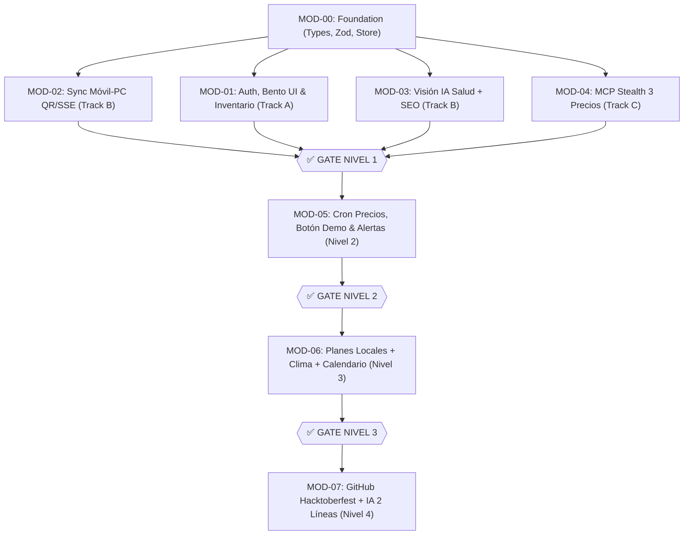

# 🗼 Control Tower — Seguimiento y Control de Módulos SDD (`.agent/modules/INDEX-control-tower.md`)

> **Propósito:** Panel de control de ingeniería en tiempo real para **Ales, Adri y Matías** (y sus agentes en **Antigravity CLI**, **Claude Code** y **OpenCode**). Cada módulo tiene su propio documento técnico con diseño SOLID, contratos, checklist de tareas, tests e invariantes de calidad.

---

## 📊 Matriz de Estado Global por Módulo

| ID Módulo | Nombre del Módulo | Nivel SDD | Track / Owner | SLA Latencia | Estado | Spec & Tracking |
| :--- | :--- | :---: | :---: | :---: | :---: | :--- |
| **MOD-00** | Foundation: Tipos, Zod Schemas & Store Atómico | 🟢 Nivel 1.0 | **Compartido** | $< 15\text{ ms}$ | `⏳ READY` | [MOD-00-foundation-store-types.md](MOD-00-foundation-store-types.md) |
| **MOD-01** | Auth, Perfiles, Bento UI & "Mi Inventario" | 🟢 Nivel 1.1 | **Track A (Ales)** | $< 100\text{ ms}$ | `⏳ READY` | [MOD-01-auth-and-inventory-ui.md](MOD-01-auth-and-inventory-ui.md) |
| **MOD-02** | Sync Cámara Móvil $\leftrightarrow$ PC (QR + SSE/Polling) | 🟢 Nivel 1.2 | **Track B (Adri)** | $< 1500\text{ ms}$ | `⏳ READY` | [MOD-02-mobile-pc-sync.md](MOD-02-mobile-pc-sync.md) |
| **MOD-03** | Visión IA: Producto, Salud ($0-100\%$) & SEO | 🟢 Nivel 1.3 | **Track B (Adri)** | $< 2800\text{ ms}$ | `✅ DONE` | [MOD-03-vision-health-seo.md](MOD-03-vision-health-seo.md) |
| **MOD-04** | Motor MCP Stealth Multi-Web & 3 Precios | 🟢 Nivel 1.4 | **Track C (Matías)** | $< 3000\text{ ms}$ | `⏳ READY` | [MOD-04-mcp-stealth-valuation.md](MOD-04-mcp-stealth-valuation.md) |
| **MOD-05** | Rastreo Periódico, Botón Demo & Alertas ($\uparrow/\downarrow$) | 🟡 Nivel 2 | **Track C + A** | $< 2500\text{ ms}$ | `🔒 LOCKED (Gate 1)` | [MOD-05-price-tracker-and-alerts.md](MOD-05-price-tracker-and-alerts.md) |
| **MOD-06** | LifeOS: Planes Locales, Clima & Calendario | 🟠 Nivel 3 | **Track C + A** | $< 1200\text{ ms}$ | `🔒 LOCKED (Gate 2)` | [MOD-06-lifeos-weather-plans-calendar.md](MOD-06-lifeos-weather-plans-calendar.md) |
| **MOD-07** | GitHub Hacktoberfest 2026 & Resumen IA 2 Líneas | 🔴 Nivel 4 | **Track C + A** | $< 2000\text{ ms}$ | `🔒 LOCKED (Gate 3)` | [MOD-07-github-hacktoberfest-ai.md](MOD-07-github-hacktoberfest-ai.md) |

### Leyenda de Estados
* `🔒 LOCKED`: Bloqueado por Gatekeeping SDD hasta completar el nivel anterior.
* `⏳ READY`: Desbloqueado y listo para implementar (contratos y specs aprobados).
* `🚧 IN_PROGRESS`: En desarrollo activo por el Track asignado.
* `🧪 VERIFYING`: Código escrito; ejecutando tests unitarios y harness de verificación.
* `✅ DONE`: Verificado de extremo a extremo, cumple SOLID y SLA de latencia.

---

## 🔄 Grafo de Dependencias de Módulos

---

## 📋 Protocolo de Actualización para Agentes

Cada vez que un agente trabaje en un módulo:
1. Abre su archivo `.agent/modules/MOD-0X-*.md`.
2. Cambia su estado en esta tabla y en la ficha del módulo a `🚧 IN_PROGRESS`.
3. Implementa siguiendo las interfaces SOLID y las restricciones de Clean Code detalladas en la ficha.
4. Ejecuta el script de verificación del harness (`node .agent/skills/sdd-gatekeeper/scripts/verify-sdd-harness.mjs`).
5. Marca las subtareas `[x]` en la ficha del módulo y actualiza el estado a `✅ DONE`.
