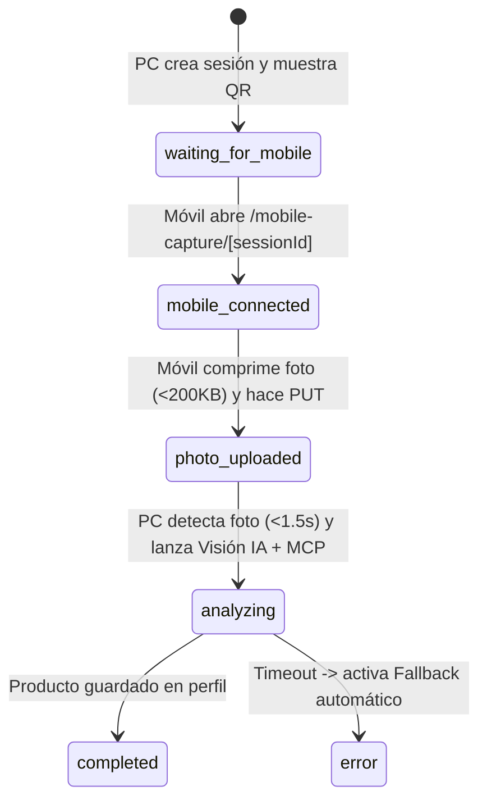

# 📱 MOD-02: Sincronización Cámara Móvil $\leftrightarrow$ Web PC (QR + SSE/Polling)

* **Nivel SDD:** 🟢 Nivel 1.2
* **Responsable:** **Track B (Adri)**
* **Estado Actual:** `⏳ READY`
* **SLA de Latencia:** Detección de foto en PC $\le 1.5\text{ s}$ tras captura en móvil.

---

## 1. Responsabilidad Única (SRP) y Diseño SOLID

Este módulo resuelve uno de los momentos más espectaculares de la demo: **disparar la cámara del teléfono desde la web del PC y ver aparecer la foto sola en el ordenador al instante, sin errores de HTTPS, CORS ni payloads gigantes**.

### Máquina de Estados de la Sesión (`CaptureSessionStatus`)

---

## 2. Solución a los 3 Riesgos Críticos de Hackathon

1. **Riesgo 1: Bloqueo de `getUserMedia` por falta de HTTPS en IP local (`192.168.x.x`).**
   * **Solución:** En `/mobile-capture/[sessionId]`, el botón principal utiliza `<input type="file" accept="image/*" capture="environment" />`, que invoca la cámara nativa del sistema operativo sin requerir HTTPS.
2. **Riesgo 2: Fotos de $12\text{ MB}$ que bloquean el Wi-Fi o dan `413 Payload Too Large`.**
   * **Solución:** Utilidad pura `compressImageFileToDataUrl(file, maxDimension = 800, quality = 0.75)` usando HTML5 `<canvas>` en el navegador móvil antes del `PUT`. Reduce una foto de $10\text{ MB}$ a $\sim 180\text{ KB}$ en $< 150\text{ ms}$.
3. **Riesgo 3: El QR apunta a `localhost:3000` y el móvil no puede entrar.**
   * **Solución:** Endpoint `/api/capture-session` detecta automáticamente la IP LAN de la máquina (desde Python con `socket`, ej. `192.168.1.34:3000`) y permite editar el host base en el modal QR (por si se usa un túnel `cloudflared` / `ngrok`), además de incluir un botón **"🧪 Simular Captura Móvil Instantánea"** para pruebas rápidas en un solo dispositivo.

---

## 3. Archivos del Módulo (`Track B` — Frontend Móvil/QR + Backend Python FastAPI)

| Archivo | Propósito | Límite Líneas |
| :--- | :--- | :---: |
| `src/lib/mobile-sync/image-compressor.ts` | Compresión en cliente con `<canvas>` a JPEG $\le 800\text{ px}$ ($<200\text{ KB}$) | $\le 90$ |
| `backend/app/routers/capture_session.py` | Endpoints FastAPI `POST /api/capture-session`, `GET` y `PUT /api/capture-session/{session_id}` + detección IP LAN en Python (`socket`) | $\le 130$ |
| `src/app/mobile-capture/[sessionId]/page.tsx` | Interfaz móvil optimizada para una mano, cámara directa (`capture="environment"`) y feedback de envío | $\le 180$ |
| `src/components/mobile-sync/MobileSyncModal.tsx` | Modal en PC con QR, URL editable anti-AP-Isolation, stepper de análisis y simulador | $\le 210$ |

---

## 4. Checklist de Control y Calidad (MOD-02)

- [ ] Generación de sesión única con QR escaneable (SVG limpio sin dependencias externas frágiles o con `qrcode`).
- [ ] Detección automática de IP LAN local (`192.168.x.x` / `10.x.x.x`) para que el QR sea accesible desde el teléfono en la misma Wi-Fi.
- [ ] Al abrir el enlace en el móvil, el PC cambia su estado a *"📱 Móvil conectado — esperando foto..."* en $< 1.5\text{ s}$.
- [ ] Compresión en `<canvas>` verificada: toda imagen subida pesa $< 400\text{ KB}$.
- [ ] En cuanto el móvil sube la foto, el PC muestra la previsualización de la imagen y dispara automáticamente `MOD-03` (Visión IA) + `MOD-04` (MCP Stealth).
- [ ] Botón de respaldo *"Simular envío desde móvil"* incluido en el modal para tests automatizados del harness.
