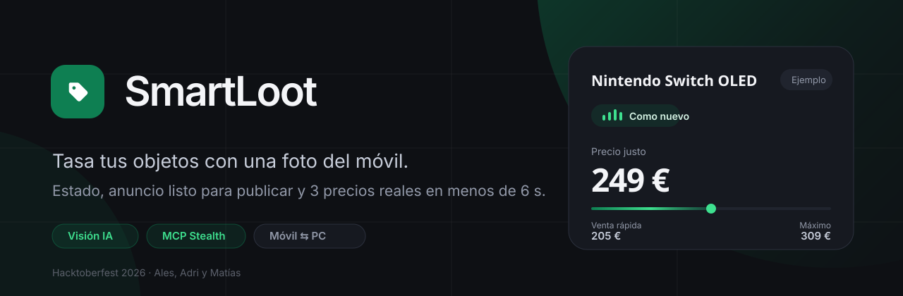
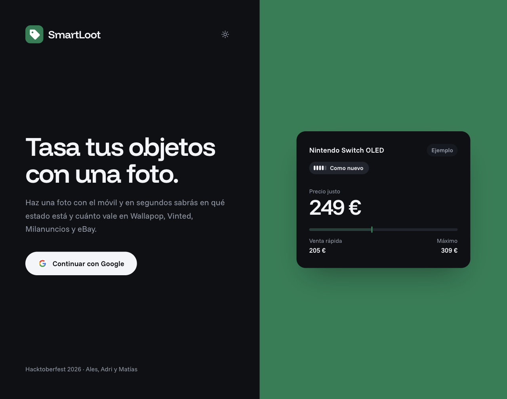
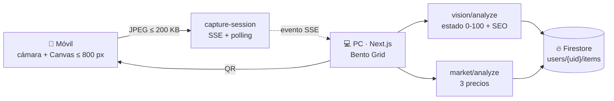

<div align="center">
  
</div>

<div align="center">

[](https://nextjs.org)
[](https://react.dev)
[](https://www.typescriptlang.org)
[](https://fastapi.tiangolo.com)
[](https://www.python.org)
[](https://firebase.google.com)
[](https://hacktoberfest.com)

**[SmartLoot](.) · Hacktoberfest 2026 · Ales, Adri y Matías**

</div>

> **Una foto con el móvil y en menos de 6 segundos sabes en qué estado está tu objeto y cuánto vale en Wallapop, Vinted, Milanuncios y eBay.**
> *Point your phone at anything you want to sell: AI grades its condition, writes the listing and returns three real market prices in under six seconds.*

---

## ✨ Qué hace

SmartLoot convierte el móvil en un tasador de segunda mano. Escaneas un QR en el ordenador, haces la foto con el teléfono y la imagen aparece sola en el dashboard del PC, ya analizada:

| | |
| :-- | :-- |
| 🔍 **Reconoce el objeto** | Nombre, marca, modelo y categoría con visión multimodal. |
| 🩺 **Diagnostica su estado** | `conditionScore` de 0 a 100 y una etiqueta: Nuevo, Como nuevo, Buen estado, Desgaste visible o Para piezas. |
| ✍️ **Escribe el anuncio** | Título SEO y descripción persuasiva listos para copiar y publicar. |
| 💶 **Da 3 precios reales** | Mínimo, medio y máximo, sacados de anuncios reales y ajustados al estado del artículo. |
| 🗂️ **Lo guarda en tu inventario** | Todo suma en el valor total acumulado de tu perfil. |

<div align="center">
  
  <sub>Pantalla de acceso. La tarjeta muestra una tasación de ejemplo con las tres medidas de precio.</sub>
</div>

---

## 🎯 Los tres precios

El motor no devuelve un número: devuelve un rango explicable, y **siempre** se cumple `0 < Pmin < Pavg < Pmax`.

| Medida | Para qué sirve | Cómo se calcula |
| :-- | :-- | :-- |
| 📉 **Pmin** | Venta rápida, liquidez hoy mismo | Percentil bajo del conjunto de comparables |
| 🎯 **Pavg** | Valor real de mercado del artículo en su estado | Mediana del conjunto, corregida por salud |
| 📈 **Pmax** | Techo para una unidad impecable | Percentil alto del conjunto |

Cada tasación viaja con su `source`: `live_mcp` si el dato viene de anuncios reales, `stealth_fallback` si la red los ha bloqueado. **Un precio de fallback nunca se presenta como dato en vivo.**

---

## 🔄 El flujo, paso a paso

```text
  PC (Next.js)                Móvil                    Backend (FastAPI)
  ─────────────               ─────                    ─────────────────
  1. "Añadir con el móvil" ─▶ QR + sesión única
                                 │
                              2. abre la cámara trasera,
                                 comprime a ≤ 800 px JPEG
                                 │
                                 └──────▶ 3. sesión de captura
                                           SSE + polling 1,2 s
  4. la foto aparece sola ◀───────────────┘
  5. visión IA ──────────────────────────▶ estado + SEO
  6. motor MCP ──────────────────────────▶ Pmin / Pavg / Pmax
  7. guardado en Firestore ──────────────▶ inventory
```

Sin intervención manual entre el paso 2 y el 7: el PC escucha la sesión y dispara el análisis en cuanto llega la imagen.

---

## 🏗️ Arquitectura



| Capa | Stack | Dónde |
| :-- | :-- | :-- |
| **Interfaz** | Next.js 16 (App Router) + React 19 + TypeScript estricto + Tailwind 4 + `lucide-react` | `src/` |
| **API** | FastAPI + Uvicorn + Pydantic v2 (`camelCase` 1:1 con `src/types/sdd.ts`) | `backend/app/` |
| **Visión** | Ollama (`qwen2.5vl`) / OpenAI Vision + fallback determinista con Pillow | `backend/app/vision/` |
| **Mercado** | Motor MCP *stealth*: User-Agents rotativos, jitter, navegador real vía CDP y caché SQLite | `backend/app/mcp/` |
| **Datos** | Firebase Auth (Google) + Firestore, **solo** a través del backend | `backend/app/store/` |

<details>
<summary><b>Ver el árbol de carpetas</b></summary>

```text
├── src/                      # Next.js: dashboard, inventario, captura móvil
│   ├── app/(dashboard)/      # Bento Grid + Mi Inventario
│   ├── app/mobile-capture/   # Cámara del móvil (QR)
│   ├── components/           # dashboard · inventory · mobile-sync · ui
│   ├── lib/                  # api, firebase, market-analysis
│   └── types/sdd.ts          # Contrato compartido con el backend
├── backend/
│   ├── app/
│   │   ├── routers/          # auth, inventario, visión, captura, mercado
│   │   ├── vision/           # análisis multimodal + fallback
│   │   ├── mcp/              # motor stealth, precios, SSE, caché
│   │   ├── store/            # repositorio Firestore + semilla demo
│   │   └── models/           # modelos Pydantic v2
│   └── tests/                # pytest (matemáticas de precios incluidas)
├── .agent/                   # Spec-Driven Development: specs, módulos, reglas
├── docs/assets/              # banner y capturas del README
├── scripts/                  # spikes y smoke tests del motor
└── docker-compose.yml        # backend + navegador CDP + web
```

</details>

---

## 🔌 API

| Método | Ruta | Qué hace |
| :----- | :--- | :------- |
| `POST` | `/api/auth` | Verifica el ID token de Firebase y devuelve el perfil |
| `GET` `POST` `DELETE` | `/api/inventory` | Lista, añade y borra artículos del usuario |
| `POST` | `/api/store/reset` | Restaura los 3 productos de demo |
| `POST` | `/api/vision/analyze` | Visión IA: estado, etiqueta y SEO |
| `POST` | `/api/capture-session` | Crea la sesión de captura para el móvil |
| `GET` `PUT` | `/api/capture-session/{id}` | Estado de la sesión y subida de la foto |
| `GET` | `/api/capture-session/{id}/stream` | SSE: la foto llega al PC en cuanto se sube |
| `POST` | `/api/market/valuate` | Tasación rápida y determinista de las 3 medidas |
| `POST` | `/api/market/analyze` | Análisis profundo con navegador real |
| `POST` | `/api/market/analyze/stream` | El mismo análisis, en streaming SSE |
| `GET` | `/api/market/health` | Salud del motor: navegador, caché y fallback |
| `GET` | `/api/vision/node-status` | Estado del nodo de visión local |

Todo pasa por el puerto `3000` gracias al `rewrite` de Next.js: **no hay CORS ni el móvil necesita otra URL que la del QR.**

---

## 🚀 Arrancar en local

**Requisitos:** Node 20+ · Python 3.11 · una cuenta de servicio de Firebase (para el login con Google).

```bash
# 1. Dependencias
npm install
npm run setup:api              # crea .venv e instala backend/requirements.txt

# 2. Configuración
cp .env.example .env           # todas las variables son opcionales salvo las de Firebase
# coloca firebase-service-account.json en la raíz (está en .gitignore)

# 3. Dos procesos, un solo puerto público
npm run dev:api                # FastAPI en http://127.0.0.1:8000
npm run dev                    # Next.js en http://localhost:3000
```

O todo junto con Docker:

```bash
docker compose up --build
```

**Proveedores opcionales**, todos con fallback si no hay clave:

- `VISION_PROVIDER=ollama` → análisis local con `qwen2.5vl:7b` (`ollama serve`).
- `OPENAI_API_KEY` → visión en la nube antes del fallback determinista.
- `DEEPSEEK_API_KEY` → recomendación de venta en dos líneas.
- `GITHUB_TOKEN` → sube el rate-limit de la API de GitHub.

**Comprobaciones rápidas:**

```bash
npm run typecheck   # TypeScript estricto
npm run build       # build de producción
npm run test:api    # pytest del backend
```

---

## 🗺️ Estado del proyecto

Construido en 9 horas con la disciplina de [Spec-Driven Development](.agent/roadmap.md): ningún nivel empieza hasta cerrar el anterior.

| Nivel | Alcance | Estado |
| :---- | :------ | :----- |
| 🟢 **1 · Core ReCommerce** | Login con Google, Bento Grid, inventario, sync móvil↔PC, visión IA + SEO, motor MCP con 3 precios | **Funcionando** · queda el gate de demo con foto real |
| 🟡 **2 · Precios en el tiempo** | Re-escaneo periódico, botón *Forzar actualización*, sparklines y centro de alertas | En curso |
| 🟠 **3 · LifeOS** | Planes locales financiados con tu inventario, clima y calendario de entregas | Planificado |
| 🔴 **4 · Hacktoberfest** | Buscador de repos con issues `hacktoberfest` y resumen IA en 2 líneas | Planificado |

> En cualquier minuto de la demo la interfaz muestra un producto terminado: **cero botones muertos y cero vistas "en construcción"**.

---

## 👥 El equipo

| Track | Persona | Dominio |
| :---- | :------ | :------ |
| **A** | **Ales** | Frontend Next.js, Bento Grid, auth y perfil, centro de notificaciones |
| **B** | **Adri** | Sync móvil↔PC (QR y cámara) y visión IA en Python |
| **C** | **Matías** | Motor MCP stealth, cron de precios y módulos LifeOS |

Trabajamos en paralelo sin pisarnos gracias a [fronteras de track estrictas](.agent/tracks/team-tracks-contract.md) y a contratos de datos compartidos (`src/types/sdd.ts` ↔ `backend/app/models/sdd.py`).

---

## 📚 Documentación

| Documento | Para qué |
| :-------- | :------- |
| [`.agent/roadmap.md`](.agent/roadmap.md) | Checklist por niveles y criterios de cierre |
| [`.agent/architecture.md`](.agent/architecture.md) | Modelos de datos y contratos REST/SSE |
| [`.agent/modules/`](.agent/modules/INDEX-control-tower.md) | Control Tower de los 8 módulos (`MOD-00` a `MOD-07`) |
| [`.agent/mcp/stealth-market-mcp.md`](.agent/mcp/stealth-market-mcp.md) | Diseño del motor anti-bot y su fallback |
| [`AGENTS.md`](AGENTS.md) | Constitución del proyecto para agentes de IA |
| [`PRODUCT.md`](PRODUCT.md) · [`DESIGN.md`](DESIGN.md) | Producto y sistema de diseño |

---

<div align="center">
  <sub>Hecho con ☕ en 9 horas para <b>Hacktoberfest 2026</b> · Ales, Adri y Matías</sub><br>
  <sub>Wallapop, Vinted, Milanuncios y eBay son marcas de terceros, citadas solo como fuentes de precios.</sub>
</div>
